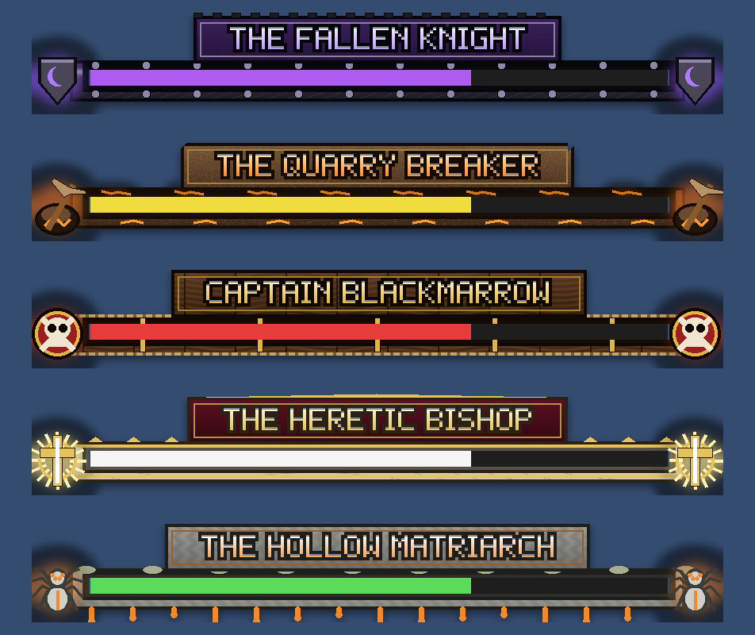

# AltarLegendary Resource Packs

Two packs for the AltarLegendaryWH server (Minecraft Java **26.1 – 26.3**):

| Pack | What it does | Download |
|---|---|---|
| **Weapon models** | Custom 3D models, textures, sounds and tooltips for the legendary weapons and items | **[⬇ AltarLegendary-26.3.zip](https://github.com/syon-b/altarlegendary-bossbars/releases/latest/download/AltarLegendary-26.3.zip)** |
| **Boss bars** | Themed boss-bar frames for the five dungeon bosses | **[⬇ AltarLegendaryBossBars.zip](https://github.com/syon-b/altarlegendary-bossbars/releases/latest/download/AltarLegendaryBossBars.zip)** |

Install: put the zip(s) in `.minecraft/resourcepacks/` and enable them in *Options → Resource Packs* (the boss-bar pack is also sent automatically by the server). They work together in any order.

---

## Boss bars

A small resource pack that adds themed boss-bar frames for the five legendary-dungeon bosses on our server:
**The Fallen Knight**, **The Quarry Breaker**, **Captain Blackmarrow**, **The Heretic Bishop** and **The Hollow Matriarch**.



## Download

**[⬇ Download AltarLegendaryBossBars.zip](https://github.com/syon-b/altarlegendary-bossbars/releases/latest/download/AltarLegendaryBossBars.zip)**

- Minecraft Java **26.1 – 26.3**
- Normally the server sends it to you automatically when you join. If you want to install it yourself: put the zip in
  `.minecraft/resourcepacks/` and enable it in *Options → Resource Packs*.
- Only adds its own font + textures (namespace `altarlegendary`), so it works alongside any other pack
  (including other boss-bar packs). Without it you just see the normal boss bar.

## Server owners

Set this in `plugins/AltarLegendaryWH/structures.yml`:

```yaml
structures:
  resource-pack:
    url: "https://github.com/syon-b/altarlegendary-bossbars/releases/latest/download/AltarLegendaryBossBars.zip"
```

## How it works

Each frame is a font glyph (`altarlegendary:bossbars`, ``–``) drawn over the vanilla bar; the plugin uses
it as the boss bar title for players who have the pack. `make_bossbar_pack.py` regenerates the pack (needs Pillow).

The boss-bar artwork is original.

---

## Weapon models — credits

The weapon-model pack is made by **WHersss**, the author of the AltarLegendaryWH plugin
([Modrinth](https://modrinth.com/plugin/altarlegendarywh) · [Discord](https://dsc.gg/whersssdevnotes)). It is re-hosted here,
updated for 26.3 (pack metadata for 26.x, removed a few broken/unused references), for players of our server.
All credit for the models and textures goes to WHersss — please support the original.
